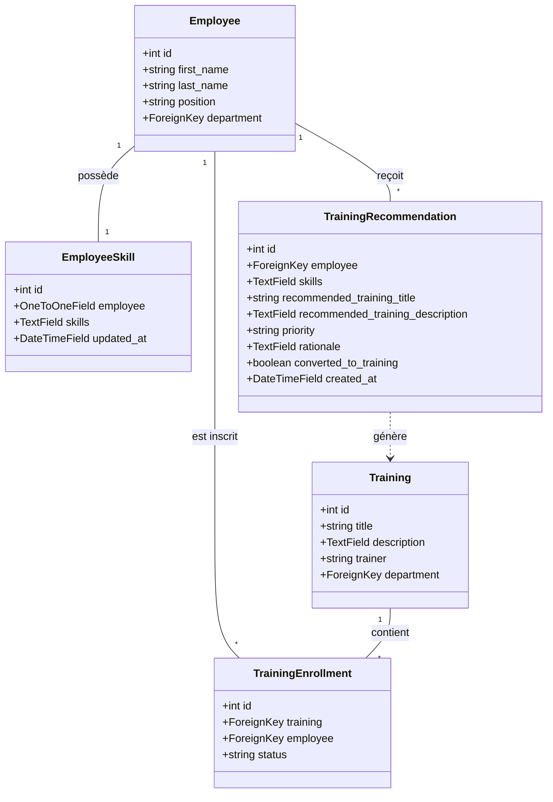

# Rapport de Projet : Plateforme RH "PeopleFlow" avec Extension d'Intelligence Artificielle

Ce document fournit une vue d'ensemble complète et détaillée de l'application de gestion des ressources humaines (RH) développée. Il contient l'ensemble des éléments indispensables (architecture, modèles de données, fonctionnalités clés, et extensions IA) pour alimenter et structurer votre **rapport de stage**.

---

## 1. Contexte du Projet et Objectifs

La plateforme **PeopleFlow** est une application web moderne de gestion des Ressources Humaines. L'objectif principal est de simplifier le quotidien des équipes RH et des collaborateurs à travers un outil centralisé, ergonomique, moderne et intelligent.

Dans le cadre des dernières évolutions (extensions IA), nous avons intégré un **moteur de recommandation de formations intelligent**. Ce moteur analyse automatiquement le profil des employés pour leur suggérer des formations adaptées et les inscrire d'office, le tout de manière fluide et sécurisée.

---

## 2. Architecture Technique de l'Application

L'application repose sur un écosystème robuste et standardisé :
*   **Backend (Serveur) :** Framework **Django (Python 3.14 / Django 5.2)** utilisant l'architecture MVT (Modèle-Vue-Template).
*   **Base de Données :** **SQLite3**, idéal pour le développement et la portabilité des données.
*   **Frontend (Interface) :** **HTML5 / CSS3 / JavaScript (Vanilla)** avec une bibliothèque de styles moderne, responsive, intégrant un mode sombre ("dark mode") et des composants haut de gamme (glassmorphisme, ombres portées, animations).
*   **Moteur d'Intelligence Artificielle :** Connecteur API **Gemini (Google)** pour l'analyse sémantique et la recommandation intelligente, avec un **moteur de secours (fallback) local** déterministe basé sur l'analyse de mots-clés si la clé API ou internet n'est pas connecté.

---

## 3. Schéma Global de la Base de Données (Modèles ORM)

L'application est structurée autour des modèles de données Django suivants :

### A. Modèles RH existants
1.  `Employee` : Informations personnelles de l'employé (nom, prénom, e-mail, poste, salaire brut/net, statut d'accès, date d'embauche).
2.  `Department` : Départements de l'entreprise (ex: IT, Logistique) avec responsable dédié (Manager).
3.  `Contract` : Gestion des contrats de travail (CDI, CDD, etc.), dates de validité, statut d'activité et fichiers associés.
4.  `LeaveRequest` : Gestion des demandes de congés et absences avec workflow de validation par les RH (En attente, Accepté, Refusé).
5.  `Payslip` : Bulletins de paie mensuels des employés avec salaire brut, net et fichier PDF téléchargeable.
6.  `TeamSchedule` : Planification des équipes (shifts de travail : Matin, Après-midi, Nuit, Repos).
7.  `Evaluation` : Cycles d'évaluations annuelles ou périodiques (notes, forces, axes d'amélioration).
8.  `JobOffer` : Gestion des offres d'emploi internes et externes.
9.  `Announcement` : Actualités et annonces importantes diffusées sur le tableau de bord.
10. `RHDocument` / `DocumentRequest` : Documents administratifs et demandes de documents par les employés.

### B. Modèles d'Extension IA (Ajoutés)


*   **`EmployeeSkill`** : Associe un profil de compétences (chaîne de texte séparée par des virgules, ex: `"Python, SQL, Git"`) à un collaborateur.
*   **`TrainingRecommendation`** : Enregistre les recommandations générées par l'IA pour chaque employé, comprenant le titre suggéré, la description du cours, le niveau de priorité (Faible, Moyenne, Élevée), la justification pédagogique de l'IA et le statut de conversion.

---

## 4. Fonctionnalités Clés et Parcours Utilisateurs

### 💼 Espace Collaborateur & Formulaires
*   **Formulaire Collaborateur (RH) :** Permet à l'équipe RH d'ajouter ou modifier la fiche complète d'un employé, y compris le champ de ses compétences professionnelles.
*   **Profil Personnel (Employé) :** Permet à chaque collaborateur de mettre à jour son mot de passe, ses informations personnelles de contact, sa photo et de déclarer lui-même ses compétences.
*   **Fiche de Détails Collaborateur :** Affiche de façon structurée l'état civil de l'employé, ses compétences actuelles (sous forme de badges), ainsi que ses onglets d'historique (congés, bulletins de paie, contrats de travail et planning).

### 🧠 Module de Recommandation IA & Inscription Automatisée (One-Click)
Il s'agit de la fonctionnalité majeure ajoutée. Elle se déroule de la façon suivante :
1.  **Vue Tableau de Recherche :** Le responsable RH accède à un tableau moderne listant tous les employés. Il peut utiliser la **barre de recherche instantanée (JavaScript)** pour filtrer les profils par nom ou poste de façon immédiate.
2.  **Lancement de l'Analyse IA (One-Click) :** Devant chaque employé figure le bouton **« Recommander & Inscrire »**.
3.  **Algorithme Intelligent (`generate_ai_recommendation`) :** 
    *   Le système vérifie si l'employé dispose de compétences sur son profil. 
    *   Si le profil contient des compétences (ex: *Python, SQL*), l'IA propose un approfondissement cohérent (ex: *Django avancé*). 
    *   Si les compétences sont vides, **l'IA adapte automatiquement sa recommandation en analysant le poste et le département de l'employé**.
    *   Un appel API Gemini (ou le parser local intelligent de secours en cas d'absence de connexion) renvoie un objet structuré en JSON.
4.  **Prévention des Doublons dans le Catalogue :** Pour éviter d'encombrer le catalogue de formations, l'application recherche d'abord si une formation portant le même titre existe déjà dans ce département. 
    *   Si elle existe, la formation existante est **réutilisée**.
    *   Sinon, elle crée une nouvelle formation (`Training`).
5.  **Inscription et Notification immédiate :** L'employé est inscrit automatiquement à cette formation (`TrainingEnrollment`), et reçoit instantanément une notification in-app sur son tableau de bord l'informant de son inscription.

---

## 5. Résumé de la Résolution d'Incidents Techniques

Durant le développement, nous avons rencontré et corrigé un incident de migration critique :
*   **Incident (`OperationalError: no such table: hr_employeeskill`) :** Dû à l'application accidentelle d'une migration intermédiaire `0011` qui supprimait la table `hr_employeeskill` alors que le modèle était toujours présent dans le code Django.
*   **Résolution :** Création d'une migration corrective **`0012`** via Django pour rétablir la table `hr_employeeskill` conformément au code Python de `models.py`. Après application du `migrate`, la cohérence de la base de données a été totalement rétablie.

---

## 6. Validation et Fiabilité (Qualité Logicielle)

L'application intègre une suite de tests unitaires et fonctionnels automatisés :
*   **30 tests automatisés** couvrent l'intégralité des modules critiques (authentification par rôle, calcul des congés restants, génération de recommandations, conversion en formations, et notifications).
*   Lancement de la suite de validation :
    ```powershell
    python manage.py test
    ```
    *Résultat : `Ran 30 tests ... OK` (Tous les tests valident avec succès).*
